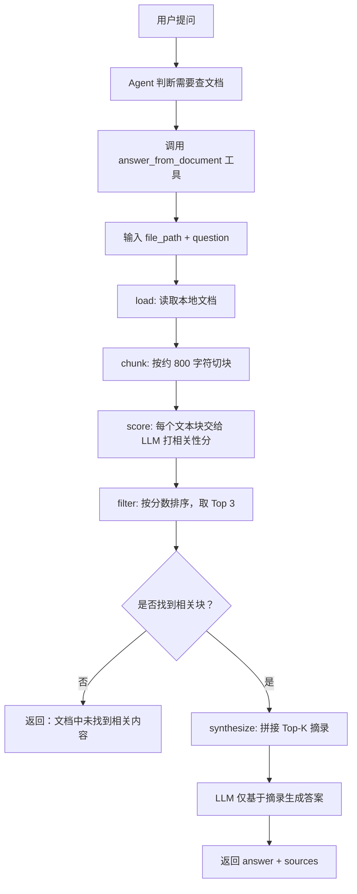
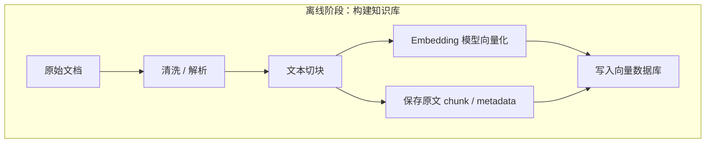
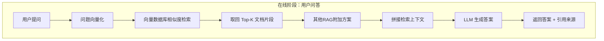

# RAG
我们知道，LLM有一个核心痛点，即不知道自己被训练后发生的事和名词，所以早期llm再遇到自己不知道的知识时极易出现编造幻觉谎言的现象，解决这种现象的方式有两个：为AI工具配备网页搜索能力，或者上RAG技术

RAG，也就是检索增强生成，有关其基本概念可见：**[从 LLM 到 Agent | RAG](https://www.claran-blog.work/go-Agent/#rag)**

因此，RAG也算是Agent能力中重要的一部分，恰好我最近做的项目也涉及一些RAG技术，所以这里我们详细讲讲RAG的实现和业务方案

## RAG伪实现
一般来讲，RAG的实现都是跟向量数据库和embedding模型绑定的，这里我们先把这些中间件降级，用质朴的代码来看看RAG是怎么基本实现的

我们这里的伪RAG流程如下：


可以看到，RAG的核心分为：文档拆分 和 文本块召回

详细实现如下，这里把伪RAG能力封装成了GraphTool：
```go
package graphTool

import (
	"context"
	"encoding/json"
	"fmt"
	"os"
	"sort"
	"strings"

	"github.com/cloudwego/eino/components/model"
	"github.com/cloudwego/eino/components/tool"
	"github.com/cloudwego/eino/compose"
	"github.com/cloudwego/eino/schema"

	"github.com/cloudwego/eino-examples/adk/common/tool/graphtool"
	"github.com/cloudwego/eino-examples/compose/batch/batch"
)

// Input 是工具调用的参数结构体
// 其 JSON 标签被 utils.InferTool 用于自动生成工具的参数 Schema
type Input struct {
	FilePath string `json:"file_path" jsonschema:"description=已上传文档文件的绝对路径"`
	Question string `json:"question"  jsonschema:"description=需要根据文档回答的问题"`
}

// Output 是工具返回的结构化结果。
type Output struct {
	Answer  string   `json:"answer"`
	Sources []string `json:"sources"` // 用于生成答案的关键摘录来源
}

// scoreTask 是喂给内部 BatchNode 工作流的单个分块输入
type scoreTask struct {
	Text     string
	Question string
}

// scoredChunk 是内部 BatchNode 工作流生成的单个分块结果
type scoredChunk struct {
	Text    string
	Score   int    // 0–10 分，表示与问题的相关性
	Excerpt string // 该分块中最相关的句子或短语
}

// scoreIn 是外部 "score" Lambda 节点的输入。
// 它通过字段映射从两个来源汇集而成：
//   - Chunks: "chunk" 节点的完整输出 ([]*schema.Document)
//   - Question: START 节点的 Question 字段 (来自 Input)
type scoreIn struct {
	Chunks   []*schema.Document
	Question string
}

// synthIn 是 "synthesize" Lambda 节点的输入
// 它通过字段映射从两个来源汇集而成：
//   - TopK: "filter" 节点的完整输出 ([]scoredChunk)
//   - Question: START 节点的 Question 字段 (来自 Input)
type synthIn struct {
	TopK     []scoredChunk
	Question string
}

// BuildTool 构建由 RAG 工作流支持的 answer_from_document 工具
// 它使用了 graphtool.NewInvokableGraphTool，该工具在每次调用时编译工作流 并支持通过内置的检查点存储（checkpoint store）进行中断/恢复
func BuildTool(ctx context.Context, cm model.BaseChatModel) (tool.BaseTool, error) {
	wf := buildWorkflow(cm)
	return graphtool.NewInvokableGraphTool[Input, Output](
		wf,
		"answer_from_document",
		"在大型上传文档中搜索与问题相关的内容，并从最相关的段落中合成带有引用的答案。"+
			"当文档太大无法放入上下文窗口时，请使用此工具代替 read_file。",
	)
}

// buildWorkflow 构建 RAG compose.Workflow（未编译状态）
// graphtool.NewInvokableGraphTool 会在每次调用时对其进行编译
func buildWorkflow(cm model.BaseChatModel) *compose.Workflow[Input, Output] {
	scoreWF := newScoreWorkflow(cm)
	scorer := batch.NewBatchNode(&batch.NodeConfig[scoreTask, scoredChunk]{
		Name:           "ChunkScorer",
		InnerTask:      scoreWF,
		MaxConcurrency: 5,
	})

	wf := compose.NewWorkflow[Input, Output]()

	// load: 从磁盘读取文件，输出单个 Document
	wf.AddLambdaNode("load", compose.InvokableLambda(
		func(ctx context.Context, in Input) ([]*schema.Document, error) {
			data, err := os.ReadFile(in.FilePath)
			if err != nil {
				return nil, fmt.Errorf("read %q: %w", in.FilePath, err)
			}
			return []*schema.Document{{Content: string(data)}}, nil
		},
	)).AddInput(compose.START)

	// chunk: 将每个 Document 拆分成约 800 字符的片段
	wf.AddLambdaNode("chunk", compose.InvokableLambda(
		func(ctx context.Context, docs []*schema.Document) ([]*schema.Document, error) {
			var out []*schema.Document
			for _, d := range docs {
				out = append(out, splitIntoChunks(d.Content, 800)...)
			}
			return out, nil
		},
	)).AddInput("load")

	// score: 通过 BatchNode 并行针对问题对每个分块进行评分
	// Chunks 来自 "chunk" 节点；Question 直接来自 START 节点
	// 两者都使用 WithNoDirectDependency，因为执行顺序已经由
	// START→load→chunk→score 的直接边缘建立
	wf.AddLambdaNode("score", compose.InvokableLambda(
		func(ctx context.Context, in map[string]any) ([]scoredChunk, error) {
        // 从 map 中手动提取字段，并进行类型断言
        // 注意：这里的 key 必须和下面 AddInputWithOptions 里的字段名完全一致
        chunks, ok1 := in["Chunks"].([]*schema.Document)
        question, ok2 := in["Question"].(string)
        
        if !ok1 || !ok2 {
            return nil, fmt.Errorf("score节点输入类型错误: Chunks 类型断言成功=%v, Question 类型断言成功=%v", ok1, ok2)
        }
        tasks := make([]scoreTask, len(chunks))
        for i, c := range chunks {
            tasks[i] = scoreTask{Text: c.Content, Question: question}
        }
        return scorer.Invoke(ctx, tasks)
    },
	)).
		AddInputWithOptions("chunk",
			[]*compose.FieldMapping{compose.ToField("Chunks")},
			compose.WithNoDirectDependency()).
		AddInputWithOptions(compose.START,
			[]*compose.FieldMapping{compose.MapFields("Question", "Question")},
			compose.WithNoDirectDependency())

	// filter: 按分数降序排列，保留最多 3 个分数 ≥ 3 的分块
	wf.AddLambdaNode("filter", compose.InvokableLambda(
		func(ctx context.Context, scored []scoredChunk) ([]scoredChunk, error) {
			sort.Slice(scored, func(i, j int) bool {
				return scored[i].Score > scored[j].Score
			})
			const maxK = 3
			var top []scoredChunk
			for _, c := range scored {
				if c.Score < 3 {
					break
				}
				top = append(top, c)
				if len(top) == maxK {
					break
				}
			}
			return top, nil
		},
	)).AddInput("score")

	// answer: 从前 K 个分块中合成回答，如果为空则返回未找到消息
	// TopK 来自 "filter" 节点；Question 直接来自 START 节点
	// 两者都使用 WithNoDirectDependency："filter" 节点通过其直接边缘控制执行顺序
	wf.AddLambdaNode("answer", compose.InvokableLambda(
		func(ctx context.Context, in map[string]any) (Output, error) {
        topK, ok1 := in["TopK"].([]scoredChunk)
        question, ok2 := in["Question"].(string)
        if !ok1 || !ok2 {
            return Output{}, fmt.Errorf("answer node input error: topK or question missing")
        }
        if len(topK) == 0 {
            return Output{
                Answer: fmt.Sprintf("在文档中未找到与 %q 相关的内容", question),
            }, nil
        }
        
        // 构造临时结构体传给 synthesize 函数，或者直接修改 synthesize 接收 map
        return synthesize(ctx, cm, synthIn{TopK: topK, Question: question})
    },
	)).
		AddInputWithOptions("filter",
			[]*compose.FieldMapping{compose.ToField("TopK")},
			compose.WithNoDirectDependency()).
		AddInputWithOptions(compose.START,
			[]*compose.FieldMapping{compose.MapFields("Question", "Question")},
			compose.WithNoDirectDependency())

	// END 节点接收来自 answer 的输出
	wf.End().
		AddInput("answer")

	return wf
}

// newScoreWorkflow 构建用于每个 BatchNode 任务的单节点内部工作流
func newScoreWorkflow(cm model.BaseChatModel) *compose.Workflow[scoreTask, scoredChunk] {
	wf := compose.NewWorkflow[scoreTask, scoredChunk]()
	wf.AddLambdaNode("score_chunk", compose.InvokableLambda(
		func(ctx context.Context, t scoreTask) (scoredChunk, error) {
			return scoreOneChunk(ctx, cm, t)
		},
	)).AddInput(compose.START)
	wf.End().AddInput("score_chunk")
	return wf
}

// scoreOneChunk 要求模型对单个分块的相关性进行评分（0–10）并提取最相关的摘录
// 解析错误会被视为 0 分，因此错误的 JSON 响应永远不会导致整个流水线中止
func scoreOneChunk(ctx context.Context, cm model.BaseChatModel, t scoreTask) (scoredChunk, error) {
	prompt := fmt.Sprintf(`请评分以下文本分块与问题的相关性。

问题: %s

文本分块:
%s

仅回复 JSON — 不要解释，不要 Markdown 代码块：
{"score": <0-10>, "excerpt": "<最相关的句子或短语，如果分数位 0 则为空字符串>"}

评分指南: 0=完全无关, 3=略微相关, 7=清晰相关, 10=直接回答了问题。`,
		t.Question, t.Text)

	resp, err := cm.Generate(ctx, []*schema.Message{schema.UserMessage(prompt)})
	if err != nil {
		// 将模型错误视为不相关，而不是中止整个批处理
		return scoredChunk{Text: t.Text, Score: 0}, nil
	}

	content := strings.TrimSpace(resp.Content)
	// 去除可选的 markdown 代码块包装
	content = strings.TrimPrefix(content, "```json")
	content = strings.TrimPrefix(content, "```")
	content = strings.TrimSuffix(content, "```")
	content = strings.TrimSpace(content)

	var sr struct {
		Score   int    `json:"score"`
		Excerpt string `json:"excerpt"`
	}
	if err := json.Unmarshal([]byte(content), &sr); err != nil {
		return scoredChunk{Text: t.Text, Score: 0}, nil
	}
	return scoredChunk{Text: t.Text, Score: sr.Score, Excerpt: sr.Excerpt}, nil
}

// synthesize 根据前 K 个分块构建提示词并生成带有引用的回答。
func synthesize(ctx context.Context, cm model.BaseChatModel, in synthIn) (Output, error) {
	var sb strings.Builder
	sb.WriteString("仅使用提供的文档摘录回答以下问题。\n\n")
	sb.WriteString("问题: ")
	sb.WriteString(in.Question)
	sb.WriteString("\n\n文档摘录:\n")

	sources := make([]string, len(in.TopK))
	for i, c := range in.TopK {
		excerpt := c.Excerpt
		if excerpt == "" {
			excerpt = c.Text
		}
		sources[i] = excerpt
		fmt.Fprintf(&sb, "[%d] %s\n\n", i+1, excerpt)
	}
	sb.WriteString("提供简洁清晰的回答。在引用来源时，请注明摘录编号，如 [1]。")

	resp, err := cm.Generate(ctx, []*schema.Message{schema.UserMessage(sb.String())})
	if err != nil {
		return Output{}, fmt.Errorf("synthesize: %w", err)
	}
	return Output{Answer: resp.Content, Sources: sources}, nil
}

// splitIntoChunks 将文本切分为最大 chunkSize 字符的分块，
// 尽可能在段落边界 (\n\n) 处断开，其次是换行符。
func splitIntoChunks(text string, chunkSize int) []*schema.Document {
	var chunks []*schema.Document
	var buf strings.Builder

	flush := func() {
		s := strings.TrimSpace(buf.String())
		if s != "" {
			chunks = append(chunks, &schema.Document{Content: s})
		}
		buf.Reset()
	}

	for _, para := range strings.Split(text, "\n\n") {
		para = strings.TrimSpace(para)
		if para == "" {
			continue
		}
		if buf.Len()+len(para)+2 > chunkSize && buf.Len() > 0 {
			flush()
		}
		// 如果段落本身超过了 chunkSize：按行拆分
		if len(para) > chunkSize {
			for _, line := range strings.Split(para, "\n") {
				line = strings.TrimSpace(line)
				if line == "" {
					continue
				}
				if buf.Len()+len(line)+1 > chunkSize && buf.Len() > 0 {
					flush()
				}
				if buf.Len() > 0 {
					buf.WriteByte('\n')
				}
				buf.WriteString(line)
			}
		} else {
			if buf.Len() > 0 {
				buf.WriteString("\n\n")
			}
			buf.WriteString(para)
		}
	}
	flush()
	return chunks
}

// 该包提供了一个由 compose.Workflow 支持的 answer_from_document（根据文档回答问题）工具。
//
// 该工作流使用字段映射（field mapping）在非相邻节点（score, answer）之间共享用户的提问，
// 而无需将提问参数穿透传递给每一个中间节点的输出类型：
//
//	开始节点 START{文件路径 FilePath, 提问 Question}
//	   │ (通过 WithNoDirectDependency 传递数据)─────────────────────────────────────┐
//	  ▼                                                                            │ 提问 Question
//	[load 节点]  os.ReadFile → []*schema.Document (读取文档)                       │
//	  ▼                                                                            │
//	[chunk 节点] 段落拆分器 → []*schema.Document (分块)                            │
//	  ▼  分块 Chunks ──────────────────────────────────────────────────────────► [score 节点]
//	                                                                                │ []scoredChunk (已评分分块)
//	                                                                               ▼
//	                                                                            [filter 节点] 获取 Top-K
//	                                                                                │ TopK (可能为空)
//	                                                                               ▼
//	                                                                            [answer 节点] ◄─ 提问 (来自 START)
//	                                                                     (在线合成答案或返回未找到)
//	                                                                                │
//	                                                                              结束 END
//
// [score] 节点包装了一个 BatchNode，其内部工作流通过并行调用 ChatModel 对每个分块进行评分（最大并发数为 5）。
```

## RAG真实现
以上我们阐释了RAG伪实现的实现方法：把文档拆分为Chunk，再让llm对Chunk与问题的匹配度进行打分，最后选取TopK返回给Agent节点流

而真正的RAG一般分为两个部分：文档建库 和 问答检索

其中，文档建库负责读取 PDF、Markdown、网页等原始资料并把内容转成纯文本或结构化文本，再把长文档切成Chunk小片段，比如每块 300-1000 tokens，再用 embedding 模型把每个 chunk 转成向量并与文档元信息一起存入向量数据库中

而问答检索这负责吧用户的问题用 embedding 转换为向量，并在向量库里找和问题向量最接近的 Top-K chunk，最后把 Top-K 片段按一定格式放进 prompt，LLM 根据检索到的资料回答，并附上引用来源

具体流程如下：




在进行Chunk切分时，我们通常会遵循一些常规切法，例如按段落、标题层级、固定 token 数、Markdown / HTML / PDF 结构、或者句子切分，以保证chunk质量

## 基础设施
上文中我们提到了两个之前没有接触到的基础设施：向量数据库与embedding模型

### 向量数据库
字面意思，就是专门用来存储向量的数据库，向量数据库不仅能能存储向量和schema，还能快速做ann检索

在这里我们使用最常用的向量数据库milvus做RAG基础设施

类比于MySQL，在milvus中，collection = 表，entity = 行

有关更多Milvus介绍：**[快速入门 Milvus Lite](https://milvus.io/docs/zh/quickstart.md)**
### embedding模型
我们知道，RAG检索的基础依赖于向量，同时我们也需要把数据先转换成向量再入库，而embedding模型就负责把数据转换成向量

这一块其实没啥好说的，在你使用的api平台找个embedding模型用就可以了
## RAG方案
其实基础的RAG很简单，就是字面意思：检索+生成，本质文档拆分+向量检索。这种基础的RAG体系已经能支持一套完整的知识库系统运作

但是，如果我们需要构建的知识库文档的量级达到10w，甚至1000w的量级呢？给你1000w份文档，怎么做合理RAG？怎么保证向量召回质量？怎么RAG链路可用？

在Milvus单库的情况下，加上一些合适的RAG策略，我们足以应对百万级文档的RAG需求，至于千万量级，可以考虑上多库主从等数据库策略了。在这里我们要做出百万级RAG方案，就需要企业级的RAG策略，针对文档切分、向量召回和Agent决策进行全面优化
### Hybrid RAG
首先，我们要优化**检索召回环节**，使用Hybrid RAG来代替纯向量检索

常规的RAG向量检索，是根据**语义向量**空间中的数学距离判断召回文本的，这就可能会导致不能正常判断并检索召回某些专有名词或者指定代码等**非常规语义向量**

**因此，我们就需要在常规RAG的语义向量检索的基础上加上关键词检索相关功能**，这就是Hybrid RAG做的事

也就是说，Hybrid Search 把两种检索合起来：
- Dense Search：语义向量检索
- Sparse / BM25 Search：关键词/全文检索

然后把两边结果融合
```
                     ┌─> Dense Vector Search ─────┐
用户问题 ────────────┤                            ├─> ... ─> topK chunks ─> LLM
                     └─> BM25 / Sparse Search ────┘
```
> Milvus 官方现在支持 hybrid search、多向量字段、BM25 sparse full-text search，以及 RRF/WeightedRanker 这类 reranking 策略

这里涉及到**BM25**这一个陌生的概念：BM25 就是传统全文检索里的经典排序算法，细节实现请看：**[BM25 算法详解：从原理到代码实现，掌握搜索与 RAG 的核心检索技术](https://blog.csdn.net/weixin_69500620/article/details/161751314)**，就算不了解具体实现，我们也可以直接把BM25当成一个关键词匹配算法的黑箱

即时实现了这两种不同的检索方式，我们还要考虑怎么合并这两条检索链路

这里我们常用RRF（Reciprocal Rank Fusion）， 不关心原始相关分数，而是看召回内容排名

我们根据假设 dense 搜索结果：
- A 排第 1
- B 排第 2
- C 排第 3

BM25 搜索结果：
- B 排第 1
- D 排第 2
- A 排第 3

RRF 会认为：

- A 两边都出现，应该靠前
- B 两边都出现，而且排名高，也应该靠前
- C 只在 dense 出现
- D 只在 BM25 出现

也就是说，如果某个 chunk 同时在 dense 和 BM25 中出现，它的优先顺位就很高，但如果它只在 dense 出现或者只在 BM25 出现，就只能进候选

这种合并方法更为稳定且简单，适合作为默认方案，重要的是Milvus reranking 文档里也支持 RRFRanker

### 分层索引：Parent-Child Chunk
其次，我们继续优化**文本切分环节**，使用l父子分块检索 Parent-Child Chunk 做更精细的文本切分，也就是我们常说的分层索引或者大小Chunk

在常规的文本切块的环节中，**如果我们切出来的Chunks过于精细短小，虽然会让检索更准，过程噪声更少，但是也会让上下文不完整，LLM 也可能看不懂前因后果**；**如果切出来的Chunks过过于完整冗长，尽管能保证上下文完整，但是会让 embedding 被稀释，检索不准，容易召回一大段泛相关内容**

于是，我们可以**对同一份带切分内容切两次，一次切大Chunk（Parent Chunk），一次切小Chunk（Child Chunk）**，这就是 Parent-Child Chunk 的基本思想，在维护父子Chunk的情况下，我们用更精细的 child chunk 做检索，用完整的 parent chunk 和 child 周边上下文做回答

于是，完整的切分流程变成了：文档 -> 检索 child chunks -> 找到最相关 child -> 根据 parent_id 找 parent chunk -> 把 parent 或相邻 child 作为上下文给 LLM

与此同时，我们有需要考虑 Parent chunk 太大时可能撑爆 prompt，这里有两种解法：
1. 对 Parent Chunk 做 Summary 摘要，并返回 parent summary + hit child
2. 取命中的 child 前后各 1 个 相邻 Child CHunk

一般在实际业务中，我们可以直接做一个Parent路由，根据 parent chunk 大小做截断：当Parent过大时采取方法一，在Parent不大时全量返回Parent并结合方法二做prompt

同时，我们在切文本语义chunk时注意维护每个chunk间的overlap，一般来说，普通文本 overlap 可以是 chunk 长度的 10% 到 20%

> Overlap 就是相邻 chunk 之间重叠一部分内容

与此同时，我们应做好良好的切分策略：针对 Markdown 文档按不同级别标题切分；针对PDF / Word，先解析成结构化文本，再按标题/段落切；针对代码部分，按特殊代码结构切等

### rerank
还记得我们说过的hybrid rag吗？是不是觉得hybrid rag本质上并没有提升rag召回的结果？这就对了，因为我们还需要做召回结果的rerank

我们之前提过的hybrid rag，主要追求的指标是**召回率**，而非召回质量，因此我们用rerank做**召回质量**的过滤

具体来说，在RRF fusion后，我们针对结果的TopN，让reranker模型同时读 query 和 chunk，并判断这个 chunk 对 query 到底有多相关，再根据判别结果筛选出TopK，也就是**重新排序已经召回出来的一小批候选文档**

简单来说，Rerank 的做法是在检索和生成之间加一个精排步骤：用 Reranker 模型给每对 (query, doc) 重新打分

在这样的模式下，Reranker 输入：
```json
{
  "query": "项目里的 Agent 如何触发？",
  "documents": [
    "文档标题...\nchunk 内容...",
    "文档标题...\nchunk 内容...",
    "文档标题...\nchunk 内容..."
  ],
  "top_n": 5
}
```

输出
```json
[
  { "index": 2, "relevance_score": 0.93 },
  { "index": 0, "relevance_score": 0.87 },
  { "index": 5, "relevance_score": 0.71 }
]
```

> 需要注意的是，reranker模型不是小llm，而是专门的reranker模型

于是现在的检索召回流程就十分完整：Hybrid Search + RRF -> 得到 top 30 -> Model Reranker -> 得到 top 5

### CRAG
但如果rerank精排后的召回内容仍然不满足query所需，怎么办呢？我们做CRAG（Corrective RAG），把检索结果当成不可信输入，先判断检索结果质量，再决定怎么回答或怎么补救

具体来说，CRAG 就是把rerank搜到的资料过滤一遍，在检索和生成之间插一个质检员（evaluator），逐个审查检索到的文档是否和问题相关，然后根据审查结果走不同的分支：
- 打分高的，说明资料靠谱，直接喂给大模型生成答案
- 打分低的，说明内部知识库里压根没找着相关内容，可以再做一次RAG链路，或者询问用户补充信息/干脆回退到 Web 搜索兜底
- 打分模糊的，就两边的结果合一起送进去，并提醒用户结果不确定性

于是，现在的RAG链路变成了：
```
用户问题
 -> Router 判断是否需要 RAG
 -> Hybrid Search
 -> RRF 融合
 -> Rerank 精排
 -> CRAG Evaluator
      ├─ correct   -> 用内部资料回答
      ├─ incorrect -> 重新检索 / Web 搜索 / 询问用户 / 返回资料不足
      └─ ambiguous -> 扩展检索 / 内部 + 外部合并 / 提醒不确定性
 -> LLM 生成
 ```
---

一个好的 CRAG evaluator 不只问“相关吗”，而是问四个东西：

1. `Relevance`：相关性

        资料是否真的围绕用户问题？是否只是命中了关键词？
2. `Coverage`：覆盖度

        资料是否覆盖回答所需关键点？
3. `Specificity`：具体性

        资料是否足够具体？是否有接口、字段、流程、条件、代码位置？
4. `Conflict`：冲突性

        资料之间是否互相矛盾？是否新旧版本说法不一致？

所以，我们也可以认为CRAG做的是 检索系统 + 质量评估器 + 纠错分支

最后，CRAG返回：
 ```json
{
  "label": "correct/incorrect/ambiguous",//充分、不充分和勉强充分
  "score": 0.86,
  "relevance": 0.92,
  "coverage": 0.81,
  "specificity": 0.84,
  "conflict": 0.05,
  "reason": "资料直接说明接口、状态和重试流程......"
}
 ```
> evaluator一般由项目小模型实现
### Self-RAG
CRAG 在检索阶段做了质检，但是其他阶段呢？我们就可以做Self-RAG做全流程自检

如果说 CRAG 是“检索结果质检”，那 Self-RAG 是把整个 RAG 流程拆成几个可审计的自检节点，在整个流程中设置四个检查点，每一步都让模型自我审视：
- 这个问题需要检索吗（Retrieve）？
- 检索到的文档相关吗（IsRel）？
- 我的回答有文档支撑吗（IsSup）？
- 这个答案对用户有用吗（IsUse）？

在链路中就是：
```
query
 -> 判断是否需要检索
 -> 检索
 -> 判断检索资料是否相关
 -> 生成答案
 -> 判断答案是否被资料支撑
 -> 判断答案是否有用
 -> 必要时重新检索、改写答案或承认资料不足
```
即一个带“自检节点”的 RAG 工作流

#### 四大检查点
1. `Retrieve`：同Router，自检这个 query 需要检索吗？需要查哪个源？用原 query 还是改写后的 query？
2. `IsRel`：同CRAG，自检检索到的资料和 query 相关吗？
3. `IsSup`：答案中的关键断言是否被资料支撑？
4. `IsUse`：这个答案对用户有用吗？是否回答了用户真正要的东西？

> 需要注意的是，Self-RAG 不是让 LLM 自己随便跑工具，而是让LLM给出结构化判断，应用代码执行检索和权限控制

在具体实现中，可以把 Self-RAG 看成一个有限状态机：
```
Step 1 Retrieve Judge
  输入：user query + minimal context
  输出：need_retrieve, source, rewritten_query, route

Step 2 Query Rewrite
  输入：query + route
  输出：retrieval query

Step 3 Retrieval
  应用代码执行：Hybrid / BM25 / Milvus / Memory / Web

Step 4 IsRel
  输入：query + chunks
  输出：相关 / 不相关 / 部分相关

Step 5 Generate Draft
  输入：query + vetted chunks
  输出：draft answer

Step 6 IsSup
  输入：query + chunks + draft
  输出：是否被来源支撑

Step 7 IsUse
  输入：query + chunks + draft
  输出：是否有用

Step 8 Repair
  如果失败：
    rewrite query
    expand retrieval
    ask clarification
    regenerate
    answer with insufficiency
```
> 我们可以发现，Self-RAG与CRAG在某些判断上极为相似，因此我们在工程上可以复用：
>
> `CRAG.relevance` -> `SelfRAG.IsRel`
>
> `CRAG.label`     -> `SelfRAG.IsSup` (弱信号)

### Adaptive RAG
我们发现，整合CRAG和Self-RAG后，CRAG 和 Self-RAG 都在给 RAG 加流程来解决问题，但这样多了好几次 LLM 调用，增加了成本，于是我们可以用Adaptive RAG做RAG最上游的路由

Adaptive RAG 就是在RAG链路最前面加了一个路由器（分类器），先判断问题的复杂度，然后决定走哪条路线：


```
用户问题
  -> Router / Classifier 判断问题类型和复杂度
  -> 选择不同路线
      简单问题：直接回答
      普通知识库问题：轻量检索
      复杂项目问题：Hybrid Search + Rerank
      高风险问题：Self-RAG / CRAG / 多轮校验
      实时问题：Web Search
      私有记忆问题：Memory Search
      工具动作：Tool Call
  -> 回答
```
核心就是：**先路由，再检索**

而我们说的 Router 就是最前面的分类器。它的输入通常是：
```
用户问题
会话上下文
可用知识源
用户身份和权限
当前产品模式
成本/延迟预算
```
输出是结构化决策，例如：
```
{
  "route": "project_rag",
  "complexity": "medium",
  "need_retrieve": true,
  "sources": ["project_docs", "code_chunks"],
  "strategy": "hybrid_rerank",
  "mode": "hybrid",
  "retrieval_source": "project_docs",
  "query": "agent_dispatch_records event_id agent_user_id",
  "reason": "问题依赖当前项目内部实现"
}
```
然后根据这种结构化决策判断：
```
要不要检索
用什么检索策略
是否需要 rerank
是否需要 CRAG / Self-RAG
是否需要 Web
是否是工具动作
是否需要拒绝或询问澄清
```

具体实现：规则 + LLM 混合 即可

规则能确定的直接走规则，规则不确定的交给 LLM Router
### Text-to-SQL RAG
有没有想过，如果我们的数据本身就是结构化的表格，比如销售数据、用户行为日志、财务报表这些，就不合适传统的 RAG ，因为对表格数据做 embedding 是非常低效的。**因此，当知识不是“文档段落”，而是 结构化数据库 时，RAG 的 retrieval 不再是“检索 chunk”，而是“生成并执行 SQL”**

也就是说，Text-to-SQL RAG本质上不再是传统RAG：

```
传统 RAG:
  query -> retrieve text chunks -> generate answer

Text-to-SQL RAG:
  query -> generate SQL -> execute query -> generate answer from rows\
```

关于 Text-to-SQL 的详细内容，我并没有深入了解，详细解析请看：**[基于 Text-to-SQL 的科研级 RAG 系统构建指南](https://blog.csdn.net/qq_65052774/article/details/156145640)**
### Agentic RAG
Agentic RAG这一块，我个人认为比起RAG，更像是**在RAG上再搭建了一层Agent，为该Agent注册各种RAG工具，再由这个Agent根据中间结果动态决定RAG链路**，因此业务极其复杂，需要把现有的RAG链路方法包装为Agent工具，涉及架构变化

因此，我们需要在一个真实系统里的 Agentic RAG 给 Agent 配这些工具：
```
hybrid_search(query, scope)
graph_search(entity_or_question)
text_to_sql(question, database_scope)
memory_search(query, user_scope)
web_search(query)
file_search(query)
code_search(query)
rerank(candidates)
summarize_sources(sources)
...
```
然后，在RAG流程中使用该Agent做ReAct循环：
```
用户问题
 -> Agent 判断问题类型
 -> 计划：需要查项目文档 + 代码 + 图谱
 -> 调 hybrid_search("RAG 上传 retry 接口")
 -> 观察：找到了 API 文档，但缺实现
 -> 调 code_search("RetryUploadJob rag upload")
 -> 观察：找到 handler/service
 -> 调 graph_search("rag-service upload retry")
 -> 观察：找到相关服务节点
 -> 判断资料足够
 -> 生成答案，并引用来源
```
并且还要考虑该Agent的沙箱边界等

总的来说，**Agentic RAG应该是前期结构规范设计的一部分，而非RAG优化流程**
### Graph RAG
我认为，Graph RAG 是脱离常规RAG和向量数据以外一种特殊的RAG实现方法，它先把文档及其相关关系和实体变成知识图谱，再基于图谱来检索和推理，是依赖 实体、关系、多跳路径、局部网络结构 的一整套系统

具体来说，GraphRAG 的思路就是：
- 由 LLM 逐篇读文档，抽取里面的实体（人、部门、产品等）和关系，构建成一张图谱
- 再用图来定位实体、扩展关系、用 Leiden 算法对图谱做社区划分，把关联紧密的实体聚成一团，然后让 LLM 为每个社区生成一段摘要
- 最后让 LLM 基于结构化上下文回答
- 提问时先定位到相关实体，沿着关系拿到子图

也就是**把文档中的知识抽成图，再基于图做检索增强生成**

#### 实体与关系
我们需要明确，在Graph RAG中，图里有两种核心东西：
- 实体 Entity
```json
{
  "name": "msg-core-service",
  "type": "Service",
  "description": "消息核心服务，负责会话、消息写入、已读游标和 Outbox",
  "aliases": ["消息核心服务", "MessageService"]
}
```
- 关系 Relationship
```json
{
  "source": "msg-core-service",
  "target": "event_outbox",
  "type": "WRITES",
  "description": "消息事务中写入 event_outbox",
  "evidence": "发送消息时同事务写入 messages、message_user_states 和 event_outbox",
  "confidence": 0.86
}
```
并且，在一个完善的Graph RAG中，不是只保存 A RELATED_TO B，而是保存有业务语义的关系：如依赖、引出、调用、包含、产出......

#### 离线构建
GraphRAG 一般分两条链路：
- 离线构建 indexing
- 在线查询 query

类似RAG的文档切分和入库，Graph RAG的离线构建就是LLM构建实体和关系的过程

这也是LLM从文档中抽取实体/关系的核心：
```
文档解析
 -> chunk
 -> LLM / 规则抽实体
 -> LLM / 规则抽关系
 -> entity resolution 实体归一化
 -> 写入图数据库
 -> 社区发现
 -> 社区摘要
```

Prompt 大概是：
```
请从下面文本中抽取实体。
实体类型包括：
- Service
- DatabaseTable
- EventTopic
...
```
返回 JSON：
```json
{
  "entities": [
    {
      "name": "msg-core-service",
      "type": "Service",
      "description": "消息核心服务，负责会话、消息写入、已读游标和 Outbox",
      "aliases": ["消息核心服务"]
    },
    {
      "name": "event_outbox",
      "type": "DatabaseTable",
      "description": "事务 Outbox 表，用于保存待发布事件",
      "aliases": []
    }
  ]
}
```
然后继续让 LLM 抽关系：
```
基于文本和已抽取实体，抽取实体之间的关系。
关系类型包括：
- CALLS
- PUBLISHES
- CONSUMES
- STORES
- OWNS
- DEPENDS_ON
- CONFIGURES
- TRIGGERS
- READS
- WRITES
...
```
返回 JSON：
```json
{
  "relationships": [
    {
      "source": "msg-core-service",
      "target": "event_outbox",
      "type": "WRITES",
      "description": "msg-core-service 在消息事务中写入 event_outbox",
      "evidence": "发送消息时同事务写入 messages、message_user_states 和 event_outbox"
    },
    {
      "source": "websocket-gateway",
      "target": "claran.message.events",
      "type": "CONSUMES",
      "description": "websocket-gateway 消费消息事件并推送在线用户",
      "evidence": "websocket-gateway 消费 claran.message.events"
    }
  ]
}
```
#### 实体归一化
不同 chunk 可能抽出：
- msg-core-service
- 消息核心服务
- msg core service
- MessageService

它们可能指同一个实体，所以要做实体归一化 entity resolution，判断这些实体是不是同一个
如果不合并，图会碎成多个节点，多跳查询会断。
- 规则：小写、去符号、统一中英文别名
- 别名表：人工维护重要实体
- LLM：判断两个实体是否同指

最终保留：
`canonical name: msg-core-service`

#### 图存储
如果想追求高效便捷地存储图类数据，我们一般会用Neo4j，**Neo4j 是一个 图数据库，专门用来存和查询“节点之间的关系”**

Neo4j快速开始：**[从 Go 使用 Neo4j](https://neo4j.ac.cn/docs/getting-started/languages-guides/neo4j-go/)**
#### Leiden 社区划分
图大了以后，不能每次查询都拿全图。社区划分可以把关系紧密的实体聚成 community，类似于“图谱自动分板块”

比如项目图谱可能分出：
- IM 消息链路：
  `msg-core-service`, `messages, event_outbox`...

- Agent 事件链路：
`agent-manager-service`, `agent-runtime-service`...

- Memory/RAG：
`memory-service`, `memory_facts`, `Milvus`...

- 文件服务：
`file-service`, `MinIO`, `OCR`...

而一般社区划分这个过程我们会用到Leiden算法：Leiden 是常用社区发现算法，能得到连通性很好的社区

有关Leiden科普：**[万字长文详解社区发现算法Leiden](https://zhuanlan.zhihu.com/p/712714461)**

工程实现详细见：**[New4j | Leiden](https://neo4j.ac.cn/docs/graph-data-science/current/algorithms/leiden/)**

#### 社区摘要
就像parent chunk不能塞进prompt一样，社区里可能几十个节点、上百条边，也不能每次全塞 prompt，所以我们可以提前对社区生成 summary：
- title: Agent 事件调度链路
- summary: 本社区描述 Agent 如何订阅 IM 事件...
- key_entities:  `agent-manager-service`, `agent-runtime-service`...

#### 在线查询 Query
查询时：
```
用户问题
 -> entity linking：识别问题中的实体
 -> 找图谱节点
 -> 扩展 1-2 跳子图
 -> 找所属社区摘要
 -> 回源 evidence chunks
 -> 合并普通 RAG 结果
 -> LLM 回答
 ```

 最终上下文不应该一堆散文，而是：
  ```
[社区摘要]
Agent 事件调度链路...

[子图关系]
agent-manager-service WRITES agent_dispatch_records
agent-manager-service CONSUMES claran.im.events
agent-runtime-service GENERATES Agent 回复

[原文证据]
对应 chunk / 文件 / 文档段落
   ```
## RAG应用
这里浅谈一下RAG的一些应用

### Memory管理
我们可以用简单的RAG做Agent的记忆管理，例如自动记忆提取、自动生成记忆、召回记忆等：

- Agent 对话结束后，异步判断是否应该生成新记忆
- 记忆冲突处理：更新旧记忆、降低旧记忆权重。
### 智能会话管理
再比如，在一个IM系统中，我们可以在会话中集成Agent+RAG的链路

我们可以在聊天记录模块做 RAG，因为在 IM 系统里，聊天记录 RAG 很有价值，我们可以找历史讨论、总结某段时间发生了什么、找某个文件/任务/结论出处、Agent 根据长期群聊上下文回答

与此同时，实现聊天记录RAG也有几个难点：噪声大、数量多、权限复杂、实时增长快、短消息语义弱、重复寒暄多等。因此我们考虑集成Adaptive RAG，避免把“好”，“nb”等口头语做RAG占用资源

更进一步，聊天记录 RAG 不应该直接“每条消息都入 Milvus”，更合理的是分层：
- 短期上下文：直接从 msg-core 拉最近 N 条
- 长期聊天 RAG：对会话片段/摘要做向量化、按时间窗口/话题聚合、生成 conversation_summary / decision / task / topic chunk

也就是说，聊天记录 RAG 的对象最好是会话片段摘要、讨论结论、任务决策等，而不是每一条碎消息

与此同时，聊天记录的rag可以做定时任务，固定时间拉取一段时间内所有信息或者每100条信息做一次收集+总结摘要，做conversation_summary / decision / task / topic chunk或者金句/用户要求记忆或者价值信息，再入strict rag

也就是：
```
  Scheduler 每分钟扫描活跃会话
  -> 找到满足条件的 conversation
  -> 创建 digest job
```

# 后记
最近真是忙死了，每天都要去医院照顾老人，去学校打体育卡，还要去京东MALL选重装旧房需要的新家具，一天到晚没啥空，累死了，忙死了，相似了，好想似，好想似，好想似，好想似，好想似，好想似，晚上又有Major，现在好想睡觉

不过也有喜报，趁着买新家具顺了个电竞椅，虽然要9月份才能搬进去

总算抽时间把这个RAG博客搞完了，虽然有些地方并没有这么细致，也没有展示工程代码......

期末周......

这篇文章后应该又会沉寂许久，接下来就是期末周+底层/拷打/八股的学习，下一篇又会是很久以后的随笔来总结近况了吧
# 参考文章
**[RAG 是什么？16 种 RAG 方案一次讲清](https://www.cnblogs.com/yupi/p/19914426)**

**[快速入门 | Milvus 文档](https://milvus.io/docs/zh/quickstart.md)**

**[数据库 | Milvus 文档](https://milvus.io/docs/zh/manage_databases.md)**

**[Go构建向量数据库：如何在1小时内完成百万级向量检索环境部署](https://blog.csdn.net/Algorhythm/article/details/153186809)**

**[BM25 算法详解：从原理到代码实现，掌握搜索与 RAG 的核心检索技术](https://blog.csdn.net/weixin_69500620/article/details/161751314)**

**[基于 Text-to-SQL 的科研级 RAG 系统构建指南](https://blog.csdn.net/qq_65052774/article/details/156145640)**

**[从 Go 使用 Neo4j](https://neo4j.ac.cn/docs/getting-started/languages-guides/neo4j-go/)**

**[万字长文详解社区发现算法Leiden](https://zhuanlan.zhihu.com/p/712714461)**

**[New4j | Leiden](https://neo4j.ac.cn/docs/graph-data-science/current/algorithms/leiden/)**